# ERD — lược đồ quan hệ

41 bảng trong `apps/api/migrations/001_init.sql`. Chia bốn cụm: tài khoản, danh mục, nguồn gốc, bán hàng.

```mermaid
erDiagram
  users ||--o| customer_profiles : "hồ sơ khách"
  users ||--o{ addresses : "địa chỉ"
  users ||--o{ carts : "giỏ"
  carts ||--o{ cart_items : "dòng"
  products ||--o{ cart_items : ""

  categories ||--o{ products : "thuộc"
  products ||--o{ product_images : "ảnh"

  suppliers ||--o{ farms : "sở hữu"
  farms ||--o{ crop_seasons : "mùa vụ"
  products ||--o{ crop_seasons : "canh tác"
  crop_seasons ||--o{ cultivation_logs : "nhật ký"
  crop_seasons ||--o{ batches : "sinh lô"
  products ||--o{ batches : ""

  batches ||--o{ batch_events : "lịch sử"
  batches ||--o{ lab_tests : "kiểm nghiệm"
  lab_tests ||--o{ lab_test_metrics : "chỉ tiêu"
  batches ||--o| qr_codes : "tem"
  qr_codes ||--o{ qr_scans : "lượt quét"
  farms ||--o{ certificates : "chứng nhận"
  batches ||--o{ certificates : ""
  batches ||--o{ batch_promotions : "giảm giá cận hạn"
  batches ||--o{ inventory : "tồn"
  warehouses ||--o{ inventory : ""

  inventory ||--o{ stock_movements : "biến động"
  batches ||--o{ stock_movements : ""

  orders ||--o{ order_lines : "dòng"
  order_lines ||--o{ order_line_allocations : "phân bổ lô"
  batches ||--o{ order_line_allocations : ""
  warehouses ||--o{ order_line_allocations : ""
  orders ||--o{ payments : "thanh toán"
  orders ||--o{ refund_requests : "hoàn tiền"
  orders ||--o{ shipments : "vận chuyển"
  promotions ||--o{ orders : "áp dụng"
  users ||--o{ orders : "đặt"

  order_lines ||--o| reviews : "đánh giá"
  products ||--o{ reviews : ""
  users ||--o{ reviews : ""

  orders ||--o{ complaints : "khiếu nại"
  batches ||--o{ complaints : ""
  complaints ||--o{ complaint_messages : "trao đổi"
  complaints ||--o{ complaint_files : "tệp"

  batches ||--o{ recalls : "thu hồi"
  recalls ||--o{ recall_contacts : "liên hệ khách"
  orders ||--o{ recall_contacts : ""

  users ||--o{ audit_logs : "thao tác"
  users ||--o{ idempotency_records : "khoá chống trùng"
  orders ||--o| idempotency_records : ""
```

## Bảng then chốt

| Bảng | Vai trò | Ghi chú thiết kế |
|---|---|---|
| `inventory` | `(warehouse_id, batch_id)` → `on_hand_qty`, `reserved_qty`, `received_at` | Không có cột available. `received_at` là khoá sắp xếp FIFO. Ràng buộc `CHECK on_hand_qty >= reserved_qty >= 0`. |
| `order_line_allocations` | Một dòng đơn có thể lấy từ nhiều lô | `reserved_qty` và `shipped_qty` tách riêng: huỷ chỉ trả `reserved`, giao hàng mới trừ `on_hand`. |
| `batches` | Lô hàng | Ba cờ độc lập: `quality_status` (kiểm nghiệm), `publication_status` (công bố), `safety_status` (thu hồi). Chỉ lô `PASS`+`PUBLISHED`+`NORMAL`+chưa hết hạn mới bán được. |
| `batch_promotions` | Giảm giá theo lô cận hạn | Áp riêng cho đúng phần khối lượng lấy từ lô đó, không phải toàn dòng. |
| `idempotency_records` | `(customer_id, key)` → `order_id`, `request_hash`, `quote_version` | Ghi trong cùng transaction với đơn, nên replay trả đúng đơn cũ. |
| `recall_contacts` | Khách thật sự đã nhận lô bị thu hồi | Sinh từ `order_line_allocations` nơi `shipped_qty > 0`, không phải từ giỏ hàng. |
| `settings` | `key/value` | `allocation_strategy` = `FIFO` \| `FEFO`. |
| `audit_logs` | `before`/`after` JSONB | Ghi khi điều chỉnh dữ liệu đã công bố, đổi trạng thái khách, ẩn đánh giá. |
