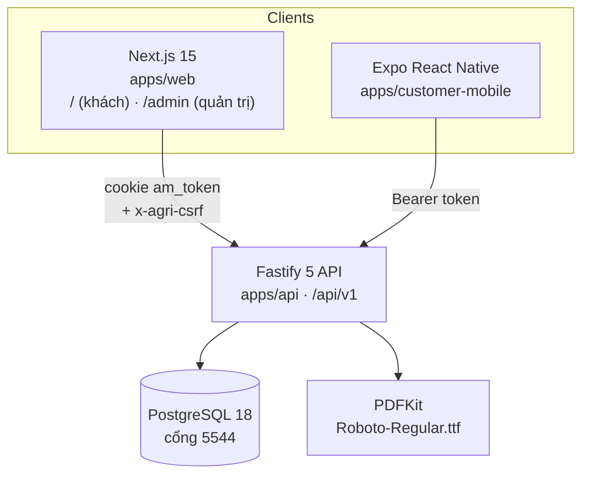
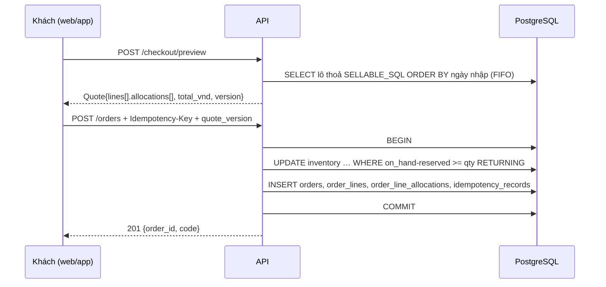

# Kiến trúc AgriMarket

## 1. Tổng quan



Ba gói, một hợp đồng dữ liệu. `apps/api` là nơi duy nhất nói chuyện với cơ sở dữ liệu; web đọc dữ liệu qua Server Components gọi thẳng API nội bộ bằng `fetch` kèm cookie phiên, ứng dụng di động dùng Bearer token. Không có tầng GraphQL, không có client ORM, không có store toàn cục phức tạp.

## 2. Tầng nghiệp vụ

| Nhóm | Vị trí | Trách nhiệm |
|---|---|---|
| Bất biến lô bán được | `apps/api/src/services/invariants.ts` | `SELLABLE_SQL`, `SHIPPABLE_SQL`, `TODAY`, `roundVnd`, `roundQty` — mọi truy vấn ghi/đọc đều nhúng các mảnh này, không viết lại inline. |
| Tính giá & phân bổ lô | `apps/api/src/services/pricing.ts` | Dựng báo giá (`buildQuote`), chọn lô theo FIFO/FEFO, áp khuyến mãi, sinh `version` (hash) để phát hiện đổi giá. |
| In PDF truy xuất | `apps/api/src/services/tracePdf.ts` | Nhúng font tĩnh Roboto-Regular (font biến thiên bị lỗi glyph), dựng hồ sơ A4. |
| Xác thực | `apps/api/src/lib/auth.ts`, `password.ts` | JWT (jose HS256) trong cookie hoặc Bearer; mật khẩu băm bằng `node:crypto` scrypt dạng `scrypt$N$salt$hash`. |

`pricing.ts` là điểm duy nhất quyết định "đơn này lấy hàng ở lô nào". Nó trả về báo giá có `version`; `POST /orders` bắt buộc gửi lại `quote_version`, lệch → `409 PRICE_CHANGED` kèm báo giá mới. Nhờ vậy khách luôn thấy đúng số tiền và đúng lô trước khi tồn kho bị giữ.

## 3. Bất biến tồn kho

Không có cột "available". Tồn khả dụng là biểu thức:

```
on_hand_qty - reserved_qty   -- của các lô thoả SELLABLE_SQL
```

`reserved_qty` tăng khi đặt hàng, giảm khi huỷ hoặc khi xuất kho; `on_hand_qty` chỉ giảm khi thực xuất. Chống bán quá tồn dựa hoàn toàn vào cơ sở dữ liệu:

```sql
UPDATE inventory SET reserved_qty = reserved_qty + $3
 WHERE batch_id = $1 AND warehouse_id = $2
   AND on_hand_qty - reserved_qty >= $3
RETURNING id
```

Không có `RETURNING` nghĩa là thua cuộc đua — transaction huỷ, khách nhận `OUT_OF_STOCK`. Không cần khoá bi quan, không cần kiểm tra ở tầng ứng dụng.

## 4. Luồng đặt hàng



`Idempotency-Key` ghi vào bảng `idempotency_records` trong cùng transaction, nên gửi lại cùng khoá trả về đúng đơn cũ thay vì tạo đơn thứ hai.

## 5. Truy xuất nguồn gốc

Chuỗi dữ liệu: `suppliers → farms → crop_seasons → cultivation_logs → batches → lab_tests/certificates → qr_codes → qr_scans`.

Điều kiện công bố (Admin V3.0 §6.3) được kiểm ở đúng một chỗ — route `POST /admin/batches/:id/publish`:

1. Lô có phiếu kiểm nghiệm `overall_result = 'PASS'` và `is_effective = true`.
2. Không còn thời gian cách ly thuốc BVTV: `harvest_date >= activity_at + isolation_days`.
3. `quality_status = 'PASS'`, `safety_status = 'NORMAL'`.

`GET /t/:token` chỉ trả lô đã `PUBLISHED`; lô nháp hoặc bị thu hồi trả 404/thông báo thu hồi. Toàn bộ payload không chứa email hay số điện thoại khách hàng — test `#20` xác nhận điều này sau khi giải nén các luồng Flate của PDF.

## 6. Xác thực và phân quyền

- Cookie `am_token` (httpOnly, SameSite=Lax) cho web; Bearer cho ứng dụng di động.
- Mọi mutation bằng cookie phải kèm header `x-agri-csrf: 1`; Bearer miễn.
- `requireUser` / `requireCustomer` / `requireAdmin` chặn ở tầng route; test `authorisation` xác nhận khách không gọi được endpoint quản trị và không đọc được đơn của người khác.
- Đăng nhập sai 5 lần → khoá tạm thời, ghi `login_attempts`.

## 7. Cơ sở dữ liệu nhúng

`scripts/db.mjs` dùng `embedded-postgres` (18.6) với `initdbFlags: ['--encoding=UTF8', '--locale=C']`, dữ liệu ở `infra/pgdata`, cổng 5544. Không cần Docker, không cần cài PostgreSQL hệ thống. `postgres.exe` giữ DLL trong `node_modules` — không xoá `node_modules` khi tiến trình còn chạy.

## 8. Giao diện

- Web: Server Components đọc dữ liệu, Client Components chỉ cho phần tương tác (giỏ hàng, form). Tailwind CSS, bảng màu `leaf`/`clay`. 43 route.
- Di động: một `App.tsx` giữ tab + stack cục bộ (`useState`), không dùng `expo-router` (peer graph của nó kéo theo reanimated, worklets, `@expo/ui` — quá nặng cho 5 tab). Ảnh sản phẩm tải từ web origin.
