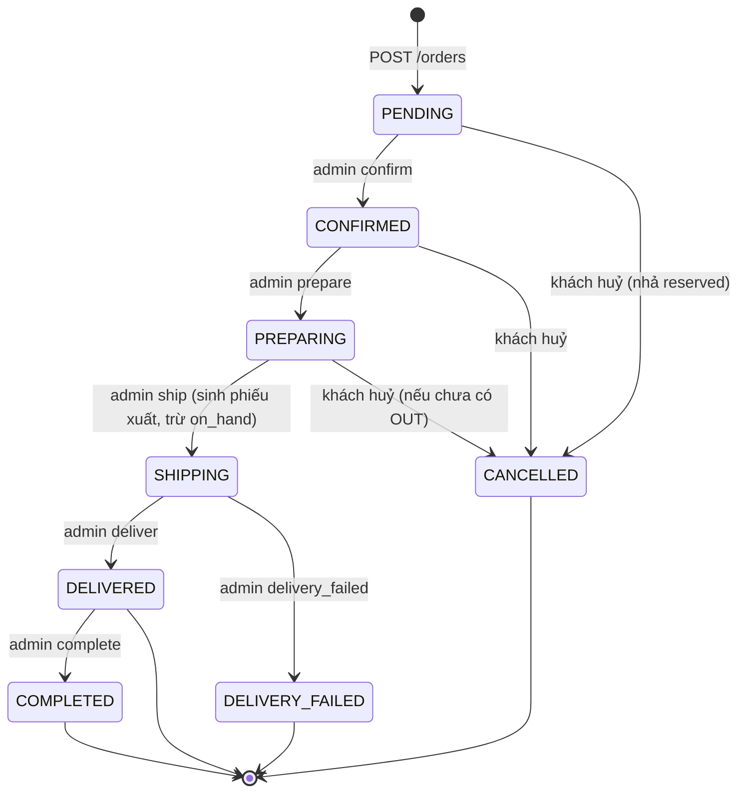
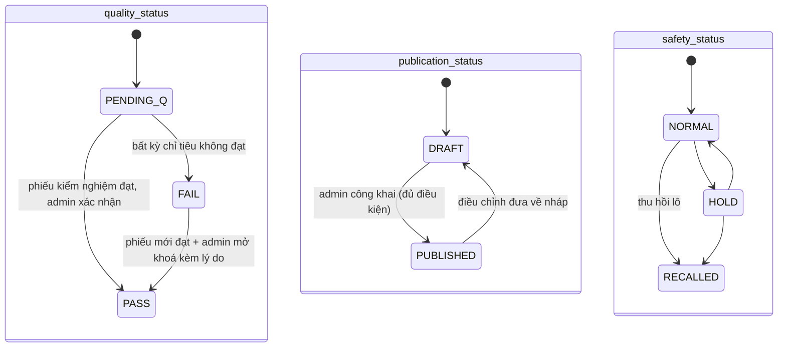
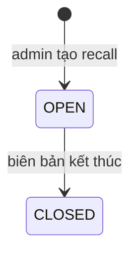
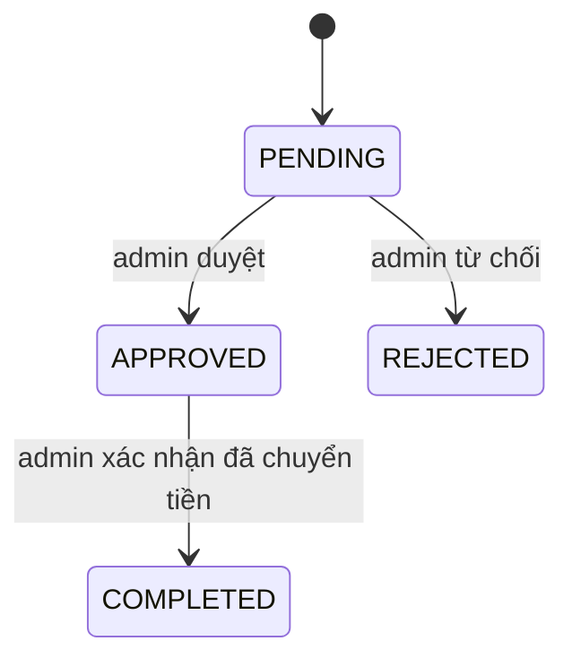
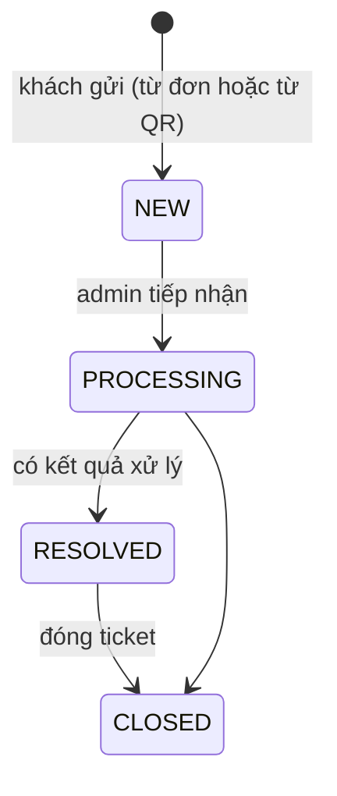

# Máy trạng thái

## 1. Đơn hàng

Nguồn: `apps/api/src/routes/adminOps.ts` (map `transitions`), `apps/api/src/routes/customer.ts` (`/me/orders/:id/cancel`).

Bất biến:

- `CANCELLED` sau khi đã xuất kho (`shipped_qty > 0`) không được phép — API trả `409 ORDER_NOT_CANCELLABLE`.
- Huỷ chỉ giảm `reserved_qty`; `on_hand_qty` bất động. Giao thất bại **không** hoàn tồn tự động (`#15`).
- Mọi chuyển trạng thái Admin ghi `audit_logs` kèm ghi chú.

## 2. Lô hàng (ba cờ độc lập)

Lô bán được khi và chỉ khi `PASS + PUBLISHED + NORMAL + expiry_date >= hôm nay` — ràng buộc nằm ở `SELLABLE_SQL`. Bất kỳ cờ nào lệch nghĩa là biến khỏi catalog, khỏi checkout, khỏi xuất kho.

Chặn công khai (`POST /admin/batches/:id/publish`): thiếu phiếu kiểm nghiệm hiệu lực `PASS`; hoặc `harvest_date` sớm hơn `activity_at + isolation_days` của lần phun thuốc gần nhất.

## 3. Thu hồi

Tạo recall trong cùng transaction: đặt `batches.safety_status = 'RECALLED'`, giải phóng `reserved` của các dòng **chưa xuất** và bật `orders.needs_reallocation`, sinh `recall_contacts` từ các dòng **đã xuất**. Mỗi liên hệ có trạng thái riêng (chưa gọi → đã liên hệ → đã xử lý) ghi `handled_at`, `note`.

## 4. Yêu cầu hoàn tiền

Doanh thu thuần = tổng `payments` đã `PAID` − tổng `refund_requests` `COMPLETED`. Yêu cầu `PENDING`/`APPROVED` **không** trừ vào doanh thu (`#19`).

## 5. Khiếu nại

`CLOSED` không nhận thêm tin nhắn (`409 COMPLAINT_CLOSED`); lịch sử trao đổi luôn giữ.

## 6. Phiên đăng nhập

`POST /auth/login` → JWT `am_token` (cookie, 7 ngày) hoặc `token` trong body cho ứng dụng di động. `token_version` tăng khi đổi mật khẩu hoặc khi Admin khoá tài khoản, làm mọi token cũ vô hiệu ngay.
