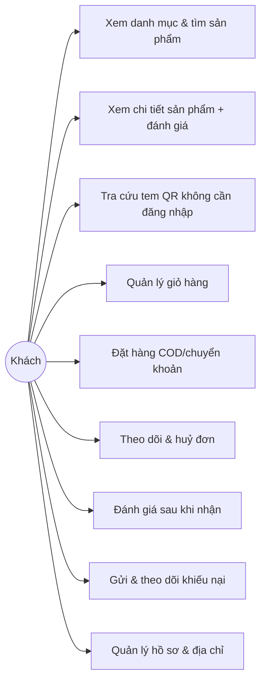
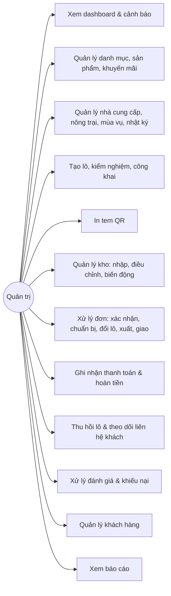

# Ca sử dụng

Tác nhân: **Khách** (CUSTOMER, có thể chưa đăng nhập) và **Quản trị** (ADMIN). Không có tác nhân nông dân/nhà cung cấp/QC — dữ liệu nguồn gốc do Admin nhập.

## 1. Khách

**UC1 — Xem danh mục, tìm sản phẩm.** Mọi người dùng. Hệ thống trả sản phẩm `ACTIVE` kèm tồn khả dụng tính từ lô `PASS + PUBLISHED + NORMAL + chưa hết hạn`. Lọc theo danh mục, khoảng giá, còn hàng; sắp xếp theo tên/giá.

**UC2 — Xem chi tiết.** Giá, đơn vị, mô tả, bảo quản, hạn dùng mặc định, danh sách lô đang bán (kèm khuyến mãi cận hạn), đánh giá đã duyệt.

**UC3 — Tra cứu QR.** Nhập mã hoặc quét bằng camera. Không cần đăng nhập. Lô `PUBLISHED` hiện đầy đủ nông trại, mùa vụ, nhật ký, kiểm nghiệm, chứng nhận; có thể tải PDF. Lô thu hồi hiện cảnh báo đỏ trước mọi thông tin khác. Mã sai → 404.

**UC4 — Giỏ hàng.** Thêm/sửa/xoá; cùng sản phẩm thì cộng lượng. Giỏ thuộc tài khoản nên dùng chung giữa web và ứng dụng.

**UC5 — Đặt hàng.** Bắt buộc đăng nhập. Preview tính tiền trên server (giá, khuyến mãi, phí giao). Xác nhận kèm `Idempotency-Key` + `quote_version`; server phân bổ lô FIFO và giữ chỗ nguyên tử. Thiếu hàng → 409, không tạo đơn. Đổi giá giữa preview và xác nhận → 409 `PRICE_CHANGED` kèm báo giá mới.

**UC6 — Theo dõi & huỷ.** Danh sách/chi tiết đơn của chính mình. Huỷ được khi chưa xuất kho; huỷ nhả `reserved`. Nếu đã thanh toán, Admin tạo yêu cầu hoàn tiền.

**UC7 — Đánh giá.** Chỉ dòng đơn trong đơn `DELIVERED`/`COMPLETED`, mỗi dòng một lần.

**UC8 — Khiếu nại.** Từ đơn đã mua hoặc từ tem QR (không cần đơn). Đính ảnh qua `/uploads`. Khách trả lời trong ticket; Admin đổi trạng thái và phản hồi.

**UC9 — Hồ sơ & địa chỉ.** Sửa tên/số liên hệ; thêm/sửa/xoá mềm địa chỉ, một mặc định. Đơn cũ giữ snapshot địa chỉ tại thời điểm đặt.

## 2. Quản trị

**A4 — Tạo lô & công khai.** Nhập ngày thu hoạch, đóng gói, hạn dùng, sản lượng, điều kiện bảo quản. Công khai bị chặn nếu: chưa có phiếu kiểm nghiệm hiệu lực `PASS`; hoặc ngày thu hoạch sớm hơn mốc cách ly thuốc BVTV.

**A6 — Kho.** Nhập kho theo lô ghi `received_at` (khoá FIFO). Điều chỉnh qua phiếu có lý do, luôn sinh `stock_movements`; giao diện không sửa trực tiếp `inventory`.

**A9 — Thu hồi.** Chọn lô + lý do + mức độ → lô chuyển `RECALLED`, ngừng bán ngay, QR công khai hiện cảnh báo. Danh sách liên hệ sinh từ các dòng **đã xuất** của lô đó; theo dõi từng khách đến khi đóng biên bản.

**A10 — Khiếu nại → thu hồi.** Chi tiết khiếu nại gắn `batch_id` có lối tắt sang màn thu hồi đúng lô.
